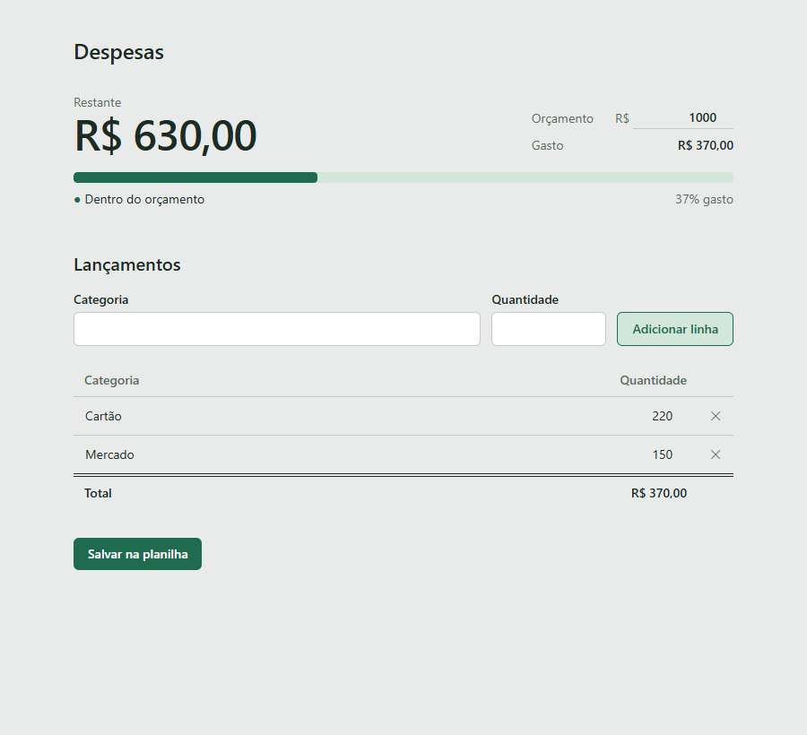

# Budget Manager

Controle de despesas pessoais em React que usa uma planilha do Google Sheets como banco de dados. Você define um orçamento, lança as despesas por categoria e acompanha quanto ainda resta, sem precisar de servidor próprio.



## Funcionalidades

- **Painel do orçamento:** mostra o valor restante em destaque, o total gasto e uma barra de progresso que muda de cor conforme o gasto: dentro do orçamento, perto do limite (80% ou mais) ou estourado.
- **Lançamentos editáveis:** adicione despesas pelo formulário, edite categoria e quantidade direto na tabela e remova linhas com um clique.
- **Sincronização com o Google Sheets:** os dados são carregados da planilha ao abrir a página e gravados nela com o botão "Salvar na planilha".
- **Animações discretas:** a barra enche ao abrir a página, os valores correm até o número novo e as linhas entram e saem com transições. Tudo é desativado quando o sistema pede movimento reduzido.
- **Responsivo:** funciona do celular ao desktop.

## Tecnologias

| Camada | Ferramenta |
|---|---|
| Interface | [React 19](https://react.dev/) com `use()` e `<Suspense>` para carregar os dados |
| Build e servidor de desenvolvimento | [Vite](https://vite.dev/) |
| Estilo | [Tailwind CSS 4](https://tailwindcss.com/) com paleta própria em `@theme` |
| Lint | [Oxlint](https://oxc.rs/docs/guide/usage/linter) |
| Dados | Google Sheets e Google Apps Script como API |

## Como funciona

```
┌──────────────┐   GET ?aba=orcamentos    ┌──────────────────┐        ┌───────────────┐
│  React (Vite) │ ───────────────────────▶ │ Google Apps Script│ ─────▶ │ Google Sheets │
│              │ ◀─────────────────────── │   (app da Web)    │ ◀───── │ aba orcamentos│
└──────────────┘   POST { acao, linhas }   └──────────────────┘        └───────────────┘
```

1. Ao abrir, o app faz um `GET` no Apps Script, que devolve as linhas da aba `orcamentos` em JSON.
2. As edições ficam no estado do React até você clicar em **Salvar na planilha**.
3. Ao salvar, o app envia todas as linhas num `POST` com `acao: "substituir"`. O script apaga as linhas antigas (mantendo o cabeçalho) e escreve as novas.

O orçamento total fica salvo no `localStorage` do navegador.

## Como rodar

### Pré-requisitos

- [Node.js](https://nodejs.org/) 20 ou superior
- Uma conta Google

### 1. Prepare a planilha

1. Crie uma planilha no Google Sheets.
2. Crie uma aba chamada **`orcamentos`**, em minúsculas e sem acento.
3. Na linha 1 dessa aba, escreva os cabeçalhos `Categoria` e `Quantidade`.

### 2. Publique a API no Apps Script

1. Na planilha, abra **Extensões → Apps Script**.
2. Cole o conteúdo de [`apps-script/Codigo.gs`](apps-script/Codigo.gs) e salve.
3. Clique em **Implantar → Nova implantação**, escolha o tipo **App da Web** e configure:
   - **Executar como:** você
   - **Quem pode acessar:** qualquer pessoa
4. Copie a URL gerada, que termina em `/exec`.

> Sempre que alterar o script, publique uma **nova versão** em *Implantar → Gerenciar implantações*. Salvar no editor não atualiza a URL.

### 3. Configure e inicie o app

```bash
cd budget-manager
npm install
cp .env.example .env
```

Abra o `.env` e coloque a URL do Apps Script:

```env
VITE_SHEETS_URL=https://script.google.com/macros/s/SEU_ID_DE_IMPLANTACAO/exec
```

Depois inicie o servidor de desenvolvimento:

```bash
npm run dev
```

O app abre em http://localhost:5173.

## Scripts

Rode dentro de `budget-manager/`:

| Comando | O que faz |
|---|---|
| `npm run dev` | Inicia o servidor de desenvolvimento com recarga automática |
| `npm run build` | Gera a versão de produção em `dist/` |
| `npm run preview` | Serve a versão de produção localmente |
| `npm run lint` | Verifica o código com o Oxlint |

## Estrutura do projeto

```
BudgetManager/
├── apps-script/
│   └── Codigo.gs                  # API que lê e grava a planilha
├── docs/
│   └── screenshot.png
└── budget-manager/                # app React
    ├── .env.example
    ├── index.html
    └── src/
        ├── App.jsx                # estado, carga e salvamento dos dados
        ├── main.jsx               # entrada do app e <Suspense>
        ├── index.css              # Tailwind, paleta e animações
        ├── components/
        │   ├── BudgetStatsDashboard.jsx   # restante, gasto e barra do orçamento
        │   ├── BudgetForm.jsx             # formulário para adicionar linhas
        │   ├── BudgetTable.jsx            # tabela editável de lançamentos
        │   ├── FormCadastro.jsx           # cadastro de clientes (fora da página atual)
        │   └── ListaCadastros.jsx         # lista de clientes (fora da página atual)
        └── services/
            └── planilha.js        # chamadas à API do Apps Script
```

## Personalização

As cores ficam centralizadas em `budget-manager/src/index.css`, no bloco `@theme`:

| Token | Cor | Uso |
|---|---|---|
| `papel` | `#e9ebea` | fundo da página |
| `pauta` | `#c3cbc5` | linhas e bordas |
| `tinta` | `#1d2b23` | texto principal |
| `lapis` | `#5c6b61` | texto secundário |
| `razao` | `#1f6b4f` | botões e barra dentro do orçamento |
| `alerta` / `estouro` | `#fab219` / `#d03b3b` | barra perto do limite / estourado |

Trocar um valor ali muda a cor em todo o app.

## Limitações conhecidas

- **A API é pública.** A URL do Apps Script aceita leitura e escrita de qualquer pessoa que a conheça. Não compartilhe o `.env` e não guarde dados sensíveis na planilha.
- **Quem salva por último vence.** O salvamento substitui a aba inteira, então se duas pessoas editarem ao mesmo tempo, a última a salvar sobrescreve a outra.
- **Orçamento por navegador.** O valor do orçamento fica no `localStorage` e não é sincronizado entre dispositivos.
